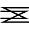

<div align="center">


# 🔭 RAW Astroculling

</div>


O **RAW Astroculling** é uma ferramenta autônoma e leve desenvolvida para astrofotógrafos realizarem a triagem automatizada (*culling*) de subexposições brutas (arquivos RAW) antes do pré-processamento e empilhamento (*stacking*). 

O software analisa a geometria das estrelas diretamente nos arquivos originais da câmera, separando automaticamente os *frames* com estrelas pontuais daqueles que sofreram arrasto (*star trailing*) por erros de rastreamento, vento ou vibrações na montagem.

---

## ✨ Principais Recursos

* **Triagem Direta em RAW:** Lê arquivos brutos sem necessidade de conversão prévia para FITS ou TIFF.
* **Suporte Multi-Formato:** Compatível com os principais sensores do mercado (`.NEF`, `.ARW`, `.CR2`, `.CR3`, `.RAF`, `.DNG`, `.ORF`, `.RW2`).
* **100% Offline:** Todo o processamento matemático ocorre localmente na sua máquina. Ideal para uso em campo e locais remotos sem acesso à internet.
* **Interface Gráfica Fluida:** Janela autônoma com processamento em segundo plano (*multithreading*) e log em tempo real, evitando travamentos durante a leitura de lotes pesados.
* **Organização Não-Destrutiva:** O programa não apaga nenhum arquivo. Ele cria duas subpastas no diretório alvo (`Boas_Redondas` e `Ruins_Esticadas`) e apenas move os arquivos conforme o resultado da análise.

---

## 🔬 Como Funciona o Processamento das Imagens?

Diferente de ferramentas baseadas em Inteligência Artificial, o **RAW Astroculling** utiliza **visão computacional e estatística astronômica clássica** para garantir precisão e previsibilidade:

1. **Extração Linear (Pré-Debayer):** Utilizando a biblioteca `rawpy` (LibRaw), o algoritmo extrai os dados lineares de 16-bits do sensor sem aplicar curvas de brilho automático ou interpolação pesada de cores, preservando a geometria real dos fótons capturados.
2. **Recorte Central (ROI):** Para evitar que aberrações ópticas naturais de borda (como *coma* ou *astigmatismo* de lentes e telescópios) causem falsas rejeições, o algoritmo isola os **50% centrais** do sensor, avaliando puramente a qualidade do rastreamento.
3. **Suavização do Padrão Bayer:** Aplica uma leve convolução Gaussiana (`Gaussian2DKernel`) na memória para mitigar o efeito quadriculado da matriz CFA (*Color Filter Array*) antes da detecção.
4. **Detecção e Filtragem Estelar:** O algoritmo `DAOStarFinder` (via `photutils`/`astropy`) localiza as fontes luminosas acima do ruído de fundo (`sigma_clipped_stats`). Estrelas saturadas (que possuem núcleos achatados e mascaram rastros) e *hot pixels* isolados são descartados.
5. **Excentricidade Ponderada pelo Fluxo:** Para cada estrela válida selecionada, o software calcula os momentos morfológicos de segunda ordem para encontrar a excentricidade ($\varepsilon$) da elipse:
   $$\varepsilon = \sqrt{1 - \frac{b^2}{a^2}}$$
   *(Onde $\varepsilon \approx 0$ representa um círculo perfeito e $\varepsilon \to 1$ representa uma linha esticada).*
   O índice final do *frame* é obtido através da **média ponderada pelo fluxo luminoso** das estrelas, garantindo que estrelas reais e brilhantes tenham peso decisivo sobre ruídos fracos de fundo.

---

## ⚠️ Aviso sobre a Versão Beta e Compatibilidade

* **Status Beta:** Este software encontra-se em fase ativa de testes (**v1.0-Beta**). Embora o motor matemático já tenha sido validado em sessões reais, ajustes de sensibilidade e melhorias de interface estão em constante evolução.
* **Compatibilidade do Instalador:** O instalador `.exe` disponível na aba *Releases* foi compilado exclusivamente para **Windows 10 e Windows 11 (64-bits)**. Usuários de Linux ou macOS podem executar o código-fonte diretamente via Python.
* **Alerta do Windows SmartScreen:** Por ser um projeto independente e em fase Beta (sem certificado de assinatura digital comercial), o Windows Defender SmartScreen pode exibir um alerta de *"Aplicativo desconhecido"* na primeira execução. Para prosseguir, clique em **"Mais informações"** e depois em **"Executar assim mesmo"**.

---

## 🚀 Como Usar

### Opção 1: Usando o Instalador (Windows)
1. Baixe 'RAW_Astroculling_windows_Setup.exe'.
2. Execute o instalador e siga as instruções na tela.
3. Abra o **RAW Astroculling**, clique em **"Procurar..."** e selecione a pasta contendo os arquivos RAW da sua sessão.
4. Ajuste o **Limite de Excentricidade** (padrão recomendado: `0.445`):
   * *Valores menores (ex: `0.380` - `0.420`):* Mais rigoroso, aceita apenas estrelas muito pontuais.
   * *Valores maiores (ex: `0.460` - `0.500`):* Mais tolerante a pequenas oscilações de guiagem.
5. Clique em **"Aplicar Triagem"** e acompanhe o progresso no log.

### Opção 2: Rodando via Código-Fonte (Python)
Caso queira rodar ou modificar o script diretamente no seu ambiente Python:

1. Clone o repositório:
   ```bash
   git clone https://github.com/brunosaisi/RAWAstroculling
   cd RAWAstroculling
   ```
2. Instale as dependências necessárias:
   ```bash
   pip install rawpy numpy astropy photutils
   ```
3. Execute o script principal:
   ```bash
   python RAW_Astroculling.py
   ```

### Ajustando o limite de excentricidade:
Dependendo da óptica e configurações usadas na captura, e dos alvos a média da excentricidade calculada pode variar, ou seja, o limite de excentricidade para estrelas redondas pode mudar dependendo do Point Spread Function (PSF) e nivel de saturação das estrelas (não saturação de cor, saturação aqui é quando o pixel do sensor atinge o valor máximo (full bucket))

---

## 🤝 Contribuições e Feedback (Testadores Beta)

Encontrou algum *bug*, falso positivo em algum modelo específico de câmera ou tem sugestões de melhoria? 
Abra uma **[Issue](../../issues)** aqui no GitHub informando:
* Modelo da câmera e extensão do arquivo RAW utilizado.
* Distância focal do equipamento e tempo de exposição do *frame*.
* O valor de excentricidade calculado pelo log.

---

## 📄 Licença

Este projeto é distribuído sob a licença MIT. Sinta-se à vontade para testar, estudar e contribuir com a comunidade de astrofotografia!
